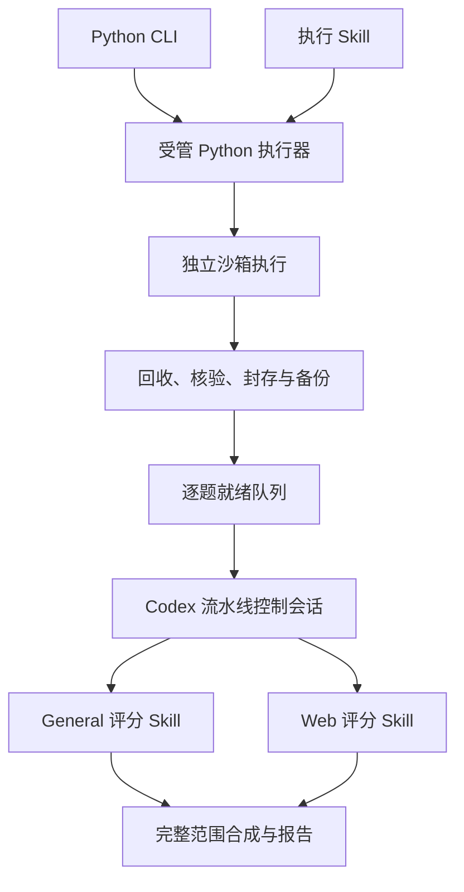

# 端到端自动化评测 AgentCube 沙箱执行阶段接入方案 v2

日期为 2026-11-04，状态为实施中。代码基线为 `d28980501f42a4f4582f7e2c54ba080a7e9bc4fd`，实现分支为 `feat/e2e-agentcube-integration`，worktree 为项目根目录的 `.agents/e2e-agentcube-integration/`。

前版为 [v1](端到端自动化评测AgentCube沙箱执行阶段接入方案-v1.md)，SHA-256 为 `608861f14098798358c582e3fda81b031129cb56c545c53142e6b699effa2d8d`。本版增加 worktree 实施约束、原始结果封存恢复、逐题评分、多 Harness 配置单元与方案版本管理。按用户明确修订，沙箱执行并发默认值为 **3**。

## 1. 架构与首期范围

采用 Python 执行器、不可变执行结果、逐题就绪队列和 Codex 评分编排。命令行与执行 Skill 共用执行器，整批评分与逐题评分共用交接协议。

首期优先验收 AStudio 的 General、Web。架构支持多配置单元，其他 Harness 随驱动和模板验收接入。显式模型与推理配置必须能够设置和核验。镜像能力缺口由维护方协调补齐后继续验收。

入口为 `eval/run_e2e.py`，实现位于 `src/e2e/`。分为任务准备、AgentCube 环境、Harness 驱动、结果封存、场景交接、持久化调度。复用现有任务解析、来源追踪和场景准备能力。

General/Web Skill 按显式执行后端与交接 Profile 路由。既有本地 Skill 的批量入口继续按对应旧协议读取，新沙箱来源由带版本适配器验证。两种执行来源均规划支持批量与逐题评分。共享源码通过现有构建器装配，批次锁定 Skill 版本和内容 SHA。

可视化平台后续从其 WildClawBench 命令构造和调度层调用独立入口。执行服务暴露稳定的事件、状态及结果索引，后续评分后端可增加 Codex 无头模式。

## 2. POC 门槛

先复现参考 `astudio-bvt.py` 的三文件统计任务。使用现有模板与 `preset_model=auto`，记录实际配置。平台认证通过环境变量或显式 POC 参考来源读取，持久化输出脱敏。

1. 创建 session 前写入创建意图，响应后立即记录 sessionId。
2. 检查 Linux 数据面、Windows VM、wgui 帮助与版本。
3. 上传公开素材，注入 Prompt 与 configure/task 请求。
4. 执行 configure、task run，按 job 身份等待结果。
5. 本机主动触发 task collect，下载产物和证据。
6. 严格检查 `answer.md` 为 `3`，核对工作区与素材映射。
7. 按 Prompt、cwd 和原生身份验证本题轨迹，记录覆盖。
8. 保存失败证据，检查 session 销毁响应。

进入正式接入要求链路、答案、工作区、轨迹归属和资源清理均可核验。原始 BVT 的宽松数字断言只作为对照。

POC 盘点唯一 run/native 身份、模型与推理回读、完成/失败/取消/待交互、完整轨迹导出和远端进程收口。正式执行持续观察原 attempt，单次平台操作和采集另设有界控制超时。BVT 的固定执行预算仅用于该技术验收任务。

## 3. 批次与目录

层级依次为 workspace、batch、unit、run、execution attempt、scoring attempt。unit 由场景/Profile、Harness、后端、模型、推理强度和模板组成，名称附配置摘要。每题每次 run 对应全新沙箱。

```text
<workspace-root>/
  workspace.json
  control/resources.sqlite
  batches/<batch-id>/
    batch.json
    selection.json
    inputs/<dataset-or-profile>/tasks/<task-id>/
      task.md
      execution/
      private-scoring/
    control/
      state.sqlite
      events.jsonl
      controllers/
    units/<unit-id>/
      unit.json
      runs/run-0001/
        tasks/<task-id>/
          executions/<execution-attempt-id>/
            staging/
            original/
              workspace/
              trace/
              artifacts/
              metadata/
            backups/
              execution-original.zip
              backup-receipt.json
            execution-ready.json
          scoring/<scoring-attempt-id>/
            source.json
            <场景标准评分工作空间>
        selected-results.json
        submission/
    exports/
    reports/
    batch-summary.json
```

`batch.json` 冻结任务范围、units、runs 和调度配置。`inputs` 区分本地私有材料和可上传的公开执行材料。批次状态库保存事务化状态及任务领取，根级资源库协调同 workspace 的评分端口与互斥操作。

`original` 为执行原件，`backups` 为独立压缩备份，`scoring` 为每次评分的独立工作副本。`source.json` 绑定父范围、执行身份、备份和评分输入摘要。`selected-results.json` 显式保留采用的尝试及历史谱系。

简单 CLI 生成单个 unit，`--plan batch.json` 声明多个 units。整个批次共享执行并发预算，按 unit 轮转补位，可配置 unit 上限。不同 batch ID 在同一工作根下独立存放。相同 batch ID 只接受同一冻结计划的显式恢复，不同计划返回冲突。

## 4. 封存、备份、恢复与分发

每题先核验远端终态、原生身份和进程收口，再下载到 staging。验证文件清单、大小、SHA 与轨迹绑定后发布 original，随后生成 ZIP 并逐成员验证。备份与回执原子发布后才生成 execution-ready 并入队。

备份失败且远端原件仍可访问时保留 session，记录待处理状态与 TTL。沙箱销毁确认前继续占用执行槽位。纯回复任务封存最终回复和过程证据。失败任务保留实际覆盖与缺口。

恢复命令验证备份并取得排他锁，核对活动评分和运行服务，保存污染副本，再创建新 generation。校验一致后切换工作入口，历史评分仍绑定原来源。恢复相同执行结果按身份和摘要去重。

评分候选采用独立复制，依赖安装、build、缓存和站点运行放入受管运行时副本。默认保留所有原始备份，清理由显式命令执行。

导出支持单题、unit/run 与批次。执行结果包包含原件、轨迹、诊断和回执。独立评分包额外包含本题私有评分材料、契约、配置和所需 Skill 身份。包内采用相对路径与逐成员摘要，导入校验版本、成员、身份和摘要，再生成本机映射。相同身份与摘要可幂等复用，冲突显式保留。

## 5. 调度与 Skill

脚本启动模式由用户直接运行 CLI，Codex 控制会话可 attach 同一批次消费就绪任务。完整 Skill 模式由执行 Skill 启动相同的受管 Python 执行器，流水线 Skill 同时观察执行和评分。

新增 `execute-sandbox-e2e` 负责启动、查询、恢复、回收和封存。新增 `orchestrate-e2e-pipeline` 支持 start/attach，领取就绪任务并调用现有 General/Web 评分编排 Skill。执行器保存 PID、启动身份、心跳和控制者租约。



采用带版本的 `task-execution-handoff-v1`，绑定父计划 SHA、完整范围、unit/run、task、执行 attempt、备份及候选。General 复用指定 task 的编排能力。Web 通过经核验的单题兼容包保持包内 manifest 与单题回执一致，父范围由独立账本保存。

`--scoring-mode streaming` 为流水线 Skill 默认模式，每题就绪即可评分。`batch` 等执行范围收口后释放可评分任务。失败、待处理和未评分均保留在父范围。最后确定性合成完整 submission，再交现有报告 Skill，复核集合、顺序、执行与评分来源、裁判身份。

`execution_concurrency` 默认 **3**，对应 `--concurrency`，兼容 `--parallel`。`scoring_concurrency` 默认 3，评分环境能力先核验。任务领取与派发意图事务化持久化，不确定的创建或发送按原身份核查。评分端口独立登记，跨 units 统一分配评分槽位。

## 6. 入口参数与验收

入口提供 poc、run、resume、status、cleanup、restore、export、import。run 的 dry-run 解析并准备任务计划。主要参数包括 workspace-root、batch-id、plan、scenario、dataset、task/task-id/category、tag/exclude-tag/modality、harness、model、reasoning-effort、concurrency、runs、agentcube-config、template、scoring-mode、scoring-concurrency。

按用户补充要求，增加 `--timeout-override`，以正整数秒设置 wgui 的 `timeout_sec`。优先级依次为 CLI 全局覆盖、unit.timeout_override、计划顶层 timeout_override、实现默认值 10800。该参数控制被测客户端的执行预算，评分规则原有超时独立保存。预检要求平台 expire_ttl 至少覆盖执行预算与额外 2400 秒的启动、收集和回收余量。

General 明确选择已登记数据集，读取对应 manifest 与冻结来源，子集单独记录范围。最新基线已支持 general-custom70-v3。Web 按 Profile 准备。只有公开执行材料进入沙箱。

验收依次进行 POC、封存恢复分发、单题正式交接、多 unit/run、流水线 Skill、发行回归。覆盖重复通知/领取、派发断连、控制重启、部分下载、备份中断、污染恢复、跨目录导入、来源漂移和缺题。先验证 2 路隔离，再验证 10 路，并留存实际重叠证据。真实评分验收要求执行与评分发生重叠，且评分槽位满足冻结配置。

## 7. 文档版本与实施记录

本版保留 v1 原件和摘要。后续实质变更递增版本，小幅修改按用户明确指示在当前版本处理。全局记忆已追加方案落盘及版本偏好。

POC 的运行结果和能力缺口由独立执行回执及实施记录保存。阶段是否通过以实际证据判定。
