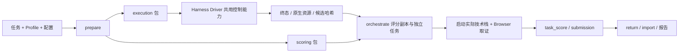

# Web 站点端到端自动化评测技术方案

更新：2026-10-09。本文说明从站点题目包到执行、轨迹采集、Browser 评分和回传报告的架构。共用 Driver 控制规则、集成步骤与各 Harness 进度见[统一集成契约](../e2e/端到端自动化评测Harness接入契约.md)，字段和公式见[Web 指标说明](Web站点端到端自动化评测指标说明.md)。操作流程见[用户手册](../../guides/web-e2e/Web站点端到端自动化评测指导手册.md)。

## 1. 场景边界与数据流

被测 Harness 根据公开题面和素材生成候选网站；独立评分 Agent 在只读评分副本上识别技术栈、启动站点，并通过当前评分入口要求的 Codex Desktop 内置 Browser 操作取证。控制器不补做网站、不修候选、不把评分消耗计入被测执行。

prepare 是管理员仓库入口；分发五个运行阶段 Skill：run、execute、orchestrate、score、report。每个 ZIP 构建期装入公共依赖，接收机器按安装清单核对名称、版本、内容 SHA；不能因题目批次不同重复安装同一运行内容，也不能只按同版本号忽略内容冲突。

`web-e2e-detailed-v1` 与 `artifactsbench-web-v1` 分别冻结，不能混包或混分。数据集/任务/Profile/Prompt/模型/权限/Judge/并发与发布身份由 manifest、task contract、运行状态共同锁定。

## 2. 共用 Driver 与场景 adapter

Driver 的应用发现、唯一控件、完整工作目录、配置回读、意图持久化、一次发送、原生身份、停止和恢复遵守共用契约。UI 单槽；后台执行和评分槽按已验范围配置。场景 adapter 负责读取 Web prepared task、候选策略、Web execution record/receipt 和评分交接。

当前代码位于 `tools/report/skills/web-e2e/execute-web-e2e/drivers/`，按 Harness 提供专属 UI/原生适配；通用底层从 `tools/report/e2e-shared/` vendoring。General 的独立 collect 阶段和回执 schema 不是 Web Driver 的输出格式，不能直接替换。

模型/权限须回读实际值。发送前落盘意图和 Prompt SHA；未知发送只续观原会话，不能补发。未知授权或无法唯一定位时暂停。题目 timeout 元数据不作为当前被测 Harness 的任务截止时间；历史 timeout 状态继续保留，UI/控制/评分基础设施限制按实际协议处理。

## 3. 轨迹采集分析

### 3.1 原生来源

| Harness | 唯一绑定与读取路径 | 解析分工 |
| --- | --- | --- |
| AstronStudio | 桌面 thread/turn 经 SQLite 反查 provider session/cwd，再定位 `.acode/sessions/.../<session>.jsonl` 或 acode-home-overlay/sessions | Web 从原生 rollout JSONL 解析；不同于 General 导出 SQLite provider events |
| WorkBuddy | 稳定 conversation/session ID + cwd，定位 `.workbuddy/projects/<编码目录>/<session>.jsonl` | 持久化响应/usage、工具 call ID 与消息时间；不能沿用 General runtime snapshot 的耗时结论 |
| QwenWork | agents.db 的 conversation/sub-chat/session/project/cwd；配合 `.qwenworkcn/projects/<编码目录>/<session>.jsonl` 与对应 logs/sessions/.../segments | transcript 确认归属；segments 提供主 turn request/response/tool/finished；精确运行时 Profile 决定 Token 是否可归一化 |
| DoubaoWork | 显式 conversation/session-directory/agent，读取绑定 session 的 agents/.../system/trajectory.jsonl | 已有工具已知小计的解析路径；native cwd、终态和完整用量缺证据时保持未知，不能凭 UI 文件生成宣称正式收口 |

[collectLocalMetrics](../../../tools/report/skills/web-e2e/execute-web-e2e/drivers/metrics/collect.mjs) 负责原生定位；[parsers](../../../tools/report/skills/web-e2e/execute-web-e2e/drivers/metrics/parsers.mjs) 复用场景无关的 native-parsers 并保持 Web 字段格式。原生来源按稳定 ID、完整 cwd 和目标主 turn 过滤，不遍历相近会话拼凑数据。

### 3.2 采集时机、完整性与落盘

资源采集在 Driver 可信终态之后、写入 execution record 时运行，使用隔离 Node 子进程和文件/遍历/输出限制。超时或原生缺失只使相应资源降级并记录原因，不改变执行终态、不触发 Prompt 重发。

`usage.collection` 记录采集器、session/attempt、字段 status/basis、来源路径/SHA、覆盖、已知小计、警告、后台与排除范围。当前 Web 资源接口以来源描述和哈希交接，不等同于 General 的完整 raw/transcript/trace-index v2 归档；不能在文档中把两条实现当成同一套正式 trace 包。

对 usage 与工具 ID 去重，排除既往轮次、后台操作和无法绑定的子代理。缺响应、隐藏零值、终值冲突、孤立结果等保留 partial/masked/unverified/unavailable；工具结果事件不重复计工具调用，不从调用次数推断工具成功率。

QwenWork 的进程级 Token 开关只对新客户端进程生效。Web Driver 在已授权、空闲且身份确认的启动路径注入开关；Profile 验证独立于开关存在。General 已验的 1.2.0 Profile 不自动成为 Web 的已验 Profile。

### 3.3 执行轨迹与评分证据的区别

执行轨迹用于身份、行为、工具与用量审计；站点分数依据 task contract/rubric 和实际浏览器交互。浏览器操作、截图、下载/原生对话框等观察属于独立评分证据，不能用被测 Agent 自报成功替代。

评分 Agent 写 criterion 的判断、理由、操作和 evidence；脚本校验完整性并确定性合分。需要 screenshot 的检查点必须有截图；工具不能完成所需交互/取证时记录评测异常，不解释为候选能力失败。

## 4. 候选与评分运行时

执行原件、只读评分副本和一次性 runtime 分开。Web 禁止 `.git`；已声明策略可保留 execution 中实际生成的 `.cache/.vite/node_modules`，按协议从哈希、复制或回传中排除并留清单，不能删除原件。旧回执按其原策略验证。

评分按 README、锁文件、scripts 和静态入口识别真实技术栈；不假设所有网站都是 Vite/React。端口冲突优先使用运行参数/环境覆盖；只有 Skill 明确允许的兼容分支可以最小修改 runtime 副本，并记录补丁，不能修复候选业务功能。停止本次服务器按 PID/进程组/服务身份，不按 Node/浏览器名称批量清理。

每题只注册精确的评分目录到 Codex Desktop 项目，独立任务、Browser、端口、evidence 和 private-scoring。失败评分 attempt 单独归档；恢复使用原 thread/cursor/attempt，不用新任务掩盖不确定性。

General/Web 的项目注册器各自独立分发，并采用相同的主窗口优先政策：无路由参数的主窗口优先于带 ChatGPT 标题的 Page 预热窗口，同等候选和重复URL失败关闭，`--page-url`可精确指定已核实窗口。该选择只影响注册入口，不改变评分状态、候选哈希、原生证据或 General 评分契约；新源码或新包不得静默替换正在执行的冻结批次。

侧栏项目标题中的添加按钮若处于 hover 才展开的裁切容器，注册器先悬停与唯一按钮关联的标题，再普通点击。强制点击隐藏按钮的布局位置可能触发下方其他控件，因此不再用于该入口。此项同时适配 General 与 Web，并保留标题歧义的拒绝条件。登录刷新失败属于 Judge 启动故障，不能记为候选能力零分或客户端执行失败。

评分控制 0.3.11 支持直接导入 Desktop 原生终态 poll：核验 thread/host/状态，以 Unix 秒解析 `completedAt`，并固化观察文件及 SHA-256。评分线程启动前必须确认当前线程已建立 Codex Desktop Browser 路由；每个评分线程都要核对与自身 `metadata.codexSessionId` 匹配的 `iab` Browser。默认评分并发固定为 3；如果当前 Desktop 会话提供的匹配路由少于三路，必须停止评分并保留 `evaluation_error`，不能静默降级为串行，也不能用父会话、headless 或自建浏览器替代。默认自动重试预算仍冻结；耗尽后可对已归档的 Browser/评分基础设施 `evaluation_error` 使用有审计的恢复机会，继续执行候选、初始评分材料、运行时停止和失败归档门禁。该恢复不会把失败 attempt 改为成功，也不修改 General 执行或评分协议。

## 5. 评分、回传和报告

- 详细 Profile：内容、交互、视觉功能分与独立美观度；美观度与功能异常互不覆盖。
- ArtifactsBench：原始 0–10 整数锚点，再确定性归一化，不补详细维度或独立美观度。
- `score_input.json` 由 Agent 填证据；finalize/validate 生成并校验 task_score，候选双副本哈希必须一致。
- submission 原子生成，return ZIP + 外部 receipt 固定身份/成员 SHA；管理员导入幂等，冲突拒绝覆盖。
- report 按同批次/Profile/用例范围生成 JSON、Markdown 和四 Sheet Excel（站点评测指标、效率对比、难度对比、用例对比明细）。效率对比必须透传 Token、模型请求数、工具调用数、任务耗时和智能体耗时，并保留每项覆盖状态；Web 既有异常零分语义与 General 有效分母不同，详见指标说明；不得在整理文档时改变协议。

## 6. 实现版本与历史验收边界

2026-10-09 当前源码的 Web Skill 版本为：`run-web-e2e 1.4.3`、`execute-web-e2e 1.21.18`、`orchestrate-web-e2e 0.3.23`、`score-web-e2e 4.5.4`、`report-web-e2e 1.2.0`；AstronStudio Driver为`1.12.8`，DoubaoWork Web Driver与共享组件为`0.8.3`。General orchestrate源码为`0.11.2`，只同步本次项目主窗口选择修复，评分契约未变。Web评分Prompt明确允许只读访问独立安装的评分Skill及其受管脚本、参考文档和运行依赖，其他项目、父目录和其他用例仍不可访问，本题写入仍限于`private-scoring/`。当前AstronStudio r3冻结包仍使用orchestrate`0.3.12`并明确指定主窗口URL，General生产安装与round1材料不替换。DoubaoWork 2.31.10使用新版Local File SSE ToolCall dispatcher记录，旧`resultLedger`适配只作为兼容路径。当前逐端验收进度、失败现场和生产准入以[统一接入契约](../e2e/端到端自动化评测Harness接入契约.md)第5章为准，以下客户端状态为2026-10-07历史材料，不外推当前发行通过。

Prompt 输入属于共用发送边界：WorkBuddy、QwenWork 在 macOS 对唯一可见编辑器先尝试受控填充；客户端暴露 contenteditable 但尚未进入可填充状态时，Driver 在同一元素上执行聚焦、全选和键盘插入回退，随后仍必须通过原有 Prompt 回读、一次发送和原生 session 绑定门禁。输入回退不能选择第二个编辑器，也不能把 DOM 文本变化单独当作发送成功。评分控制器对 `evaluation_error` 保留异常语义，并允许在 `max_retries` 范围内归档当前 attempt、恢复评分初始输入、重新 preflight 和创建新评分线程；该路径不改变候选哈希，也不把基础设施异常转换成能力零分。

本机只读检查得到的状态如下：AstronStudio Driver `1.12.3`、客户端 `3.3.1`，端点、状态库、模型/权限控件和无活动任务检查通过；QwenWork Driver `1.12.5`、客户端 `1.2.0`，端点、agents 数据库、项目选择器、模型/权限和原生文件夹助手通过；DoubaoWork Driver `0.8.2`、客户端 `2.31.10`，端点、原生来源、页面和锁屏检查通过；WorkBuddy Driver `1.10.0`、客户端 `5.5.6` 虽端点和数据库可读，但当前工作区输入控件未在前台页面，probe 返回 `ready=false`，因此不能进入生产执行门禁。

DoubaoWork 最新 5 题批次 `web-macos-doubao-production-20261007` 已完成完整闭环：`execution-receipt.json` 的 `integrity.valid=true`，5/5 为 `SUCCEEDED/completed`，默认调度占用为 3；评分控制状态为 `COMPLETED`，已生成正式 `submission.json`、JSON/Markdown/四 Sheet Excel 报告。该批次模型回读为“自动 高”、权限为“全部允许”；Token、模型请求数和成本均为 `unavailable`，工具调用为 `partial`（已知小计 176），智能体耗时 5/5 有效（3838 秒），执行流程耗时仅部分覆盖，均不得补零。

当前四个 Harness 仍未整体放行。基于当前 HEAD 新准备的 10 题生产模拟批次 `web-macos-four-harness-production-20261007` 已启动 AstronStudio 串行验收：前 3 题成功，第 4、6、7 题的原生 turn 因 provider 返回 `no valid authorization / insufficient quota` 进入 `INFRA_FAILED`，批次安全终止，未生成有效 execution receipt；这不是候选 workspace 或 Driver 重发问题，失败题 Prompt 已发送且保留完整证据。WorkBuddy、QwenWork、DoubaoWork 的 10 题正式模拟必须在 AstronStudio 通过后按同一批次顺序继续，历史 10 题目录不替代当前批次。

WorkBuddy 当前 HEAD 的 5 题执行回执已通过 `integrity.valid=true`，实际模型为 `xopglm52`、默认执行槽位为 3；评分已完成 001、003、004、005，Task 002 的默认评分 attempt、一次容量恢复 attempt 和唯一额外容量恢复机会均返回 `Selected model is at capacity. Please try a different model.`，因此 WorkBuddy 暂无有效 submission。该失败现场保留在评分状态和 attempt 归档中，不把它转换为候选能力零分。

本轮按用户要求逐端完成五题验收，执行和独立评分默认三路，取得有效 execution receipt、`submission.json`、return/import receipt 和四 Sheet 报告。四端均通过后才启动新的十题正式批次；不以历史 canary、三槽参数或异常占位分证明生产通过。缺失的 Token、请求数、工具数或耗时继续保留 `null`/`partial`/`unavailable`，不得从上下文占用或订阅显示换算。AstronStudio、DoubaoWork 的当前五题受控通过范围与 WorkBuddy/QwenWork 剩余门禁，以共用契约第5章和对应原生材料为准。

源码入口：[Web Driver 契约](../../../tools/report/skills/web-e2e/execute-web-e2e/references/driver-contract.md)、[资源采集接口](../../../tools/report/skills/web-e2e/execute-web-e2e/references/resource-metrics.md)、[评分 JSON 契约](../../../tools/report/skills/web-e2e/score-web-e2e/references/scoring-contract.md)、[浏览器取证](../../../tools/report/skills/web-e2e/score-web-e2e/references/browser-interaction-scoring.md)。历史运行细节保留在 evidence/archive，当前进度只更新共用契约。

2026-10-09 新源码修复恢复优先时的队列补位忙循环，以及 current 模型批次在新派发前的模型一致性门禁；Web 资源采集器 1.1.4 增加 QwenWorkCN 1.2.5 的独立精确 Profile，实测对账与冻结历史分开。评分控制 0.3.15 统一使用已有恢复预算总量，允许已经过认证恢复的评分题在独立上限内申请美观度基础设施恢复，仍保留全部失败 attempt 和原生终态。上述均为 Web 独立适配，General 生产安装、共享原生计量公式及 round1 未修改。新源码测试通过不能替代新版本真机验收。

0.3.17 的 Browser 初始化允许评分线程在一次面板预热仍未建立本线程路由时，用官方 cua.createBrowserTab("iab", 实际入口 URL) 创建一次自己的 Browser，然后核验 metadata.codexSessionId。空清单不等于不可创建；真正初始化失败、归属不符或取证缺失仍为 evaluation_error。控制会话 about:blank 探针只证明初始化入口可用，不作为评分证据。

QwenWork Web Driver1.12.7 将 macOS 与 Windows 截图统一为绑定页面的有界 CDP capture；高层字体/布局等待不再影响发送后脱离。截图失败仍阻断正式收口，既有一次发送、会话绑定和候选冻结门禁不变；General独立实现及生产安装未调整。Qwen r3旧13包因发送后截图超时进入attention，使用新14独立包仅续观同一attempt，不改旧manifest。

execute1.21.16/Qwen Web Driver1.12.9 在正常执行、恢复及probe结束时有界断开公开connectOverCDP传输，保持目标Electron进程。观察、attention落盘及最终采集必须await完成后才执行finally；异步错误进入原try/catch，不能因提前断开丢失原attempt的结果。首次独立1.21.15真机恢复暴露提前finally问题并保留现场，该版不准入；1.21.16已在035同attempt完成SUCCEEDED和disconnected记录，主进程仍在。活动期重连与真实三路峰值继续独立验收，不以55项测试或一次收口宣布通过；General代码、生产安装和round1不替换。

Codex Desktop评分路由的预热不等于可评分。2026-10-09进一步核验发现，失败时正确会话后端存在，信息答复晚于5秒发现窗口；扫描其他会话时的路由拒绝包含正常隔离行为，同时出现的thread/read格式错误没有被证明直接导致Browser发现失败。完整宿主重建及相近配置刷新后，031/033/035均通过实际about:blank创建和自身归属检查，原分数SHA未变；只证明三条Browser健康恢复，WorkBuddy有效评分仍为1/5。详细证据和根因边界见[专项诊断](Codex浏览器评分异常诊断与恢复验证-20261009.md)。

编排0.3.18新增站点启动前的60秒Browser就绪窗口，最多3次发现，空清单退避2秒/5秒，实际创建最多一次；只有本线程唯一iab、唯一创建tab和实际AX状态全部通过校验后才启动站点。外层策略不会改变Codex内置5000毫秒等待。功能或美观度evaluation_error触发暂停补位，保留已活动线程的等待/校验动作及原预算；异常submission仍可审计，但整批保持NEEDS_ATTENTION。旧Prompt不改写，旧结果字段仅在读取时分类；修改限于Web编排，General和评分Rubric不变。

0.3.19对就绪记录作真机修正：外层窗口180秒，文档在计时前读取；首调用精确结束时间未知时允许保存实际外部完成界限并标记精度，不反推精确时间。最终健康证明有效期仍60秒，3次发现/一次创建、归属、deadline与评分预算不变。WorkBuddy r2新线程回归仍为空清单，显示线程的只读对照也未恢复；031/033已达既有恢复上限，整批未通过。具体现场、独立发行验证和剩余门禁见专项诊断及共用契约。

0.3.20就绪流程增加窗口内一次公开REPL复位，并为收到明确人类授权的指定题提供仅一次额外评分恢复记录入口；默认预算保持，授权与原分数SHA持续复核。WorkBuddy新三个评分线程已各自READY并进入真实评分，完整收口仍待验；生产状态以统一契约及实际回执为准。
