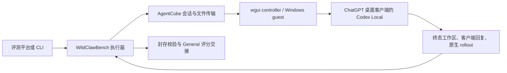

# 沙箱平台接入 ChatGPT 桌面客户端设计

日期：2026-11-20\
状态：待评审，已核对源码与官方文档，待目标 Windows VM 验证

## 决策摘要

在 AgentCube 的 Windows VM 内安装官方 **ChatGPT 桌面客户端**，以 `chatgpt-desktop` 注册第五个 wgui 产品。首期评测配置为 **客户端内的 Codex · Local · Windows native**。wgui 通过客户端界面打开本题目录、新建聊天、确认模型和权限，再提交原题。评测平台沿用 WildClawBench v1 入口，AgentCube 沿用现有会话、路由、文件传输和回收接口。 [Windows 客户端](https://learn.chatgpt.com/docs/windows/windows-app) · [Codex 执行环境](https://learn.chatgpt.com/docs/environments/modes)

先在目标 VM 完成一题本地文件读写，验证客户端提交、完成信号、终态文件和原生轨迹能否绑定为同一次执行。通过后接 WildClawBench 执行器和评测平台，首期开放 General。发布单位绑定独立 Windows 模板、客户端版本和已验证模型配置。 [AgentCube 接入方案 v2](../../design/e2e-sandbox/端到端自动化评测AgentCube沙箱执行阶段接入方案-v2.md)

## 背景与范围

| 层级 | 当前源码基线 | 接入范围 |
|---|---|---|
| AgentCube 沙箱服务 | workload manager 和 router 提供通用的会话与执行接口 | 复用创建、查询、文件传输、销毁及 TTL |
| WindowsAgentArena / wgui | `RunRequestV2` 和 `ProductRegistry` 已支持 AStudio、WorkBuddy、QwenWork、DoubaoWork | 增加 ChatGPT 产品契约、Windows UI 驱动、终态识别及轨迹导出 |
| waa-agentcube | 按 namespace 和模板名登记镜像 digest、`waa_commit` | 注册独立试点模板并保存实际部署核验记录 |
| WildClawBench | 当前 `DRIVERS` 映射包含 AStudio、WorkBuddy，`describe` 用驱动注册决定 profile 是否可用 | 增加驱动、profile、轨迹绑定、封存和重放验证，复用 General 评分交接 |
| astudio-eval-platform | 通过执行器 `describe` 获取选项，经模板绑定创建批次 | 发布试点选项，显示请求值、实际值和运行证据 |

“支持四种 Harness”对应控制层产品清单。第五个产品通过 wgui 验收后，还需完成 WildClawBench 驱动注册和平台发布，才能从评测平台创建正式批次。 [源码导航](../../guides/agentcube-source-navigation.md) · [内置产品适配](../../guides/agentcube-builtin-harnesses.md)

首期以普通本地目录为项目，每题使用独立 VM 和新聊天，覆盖纯回复和本地文件产物。首个正式 profile 固定一个已实测的模型与推理组合，目录、权限和账号环境随批次冻结。Web 场景、Work、Worktree、Cloud 和需要原生 Skill、插件或额外应用的题目分别验收后再扩展。

## 架构与执行流程



1. **创建。** 冻结批次和 attempt 身份，记录创建意图和返回的 AgentCube session ID。检查实际模板、镜像、wgui 协议与客户端版本，再检查 Windows 交互会话、账号、Codex 模式与模型可用性。
2. **准备。** 用 `wgui workspace upload` 上传公开素材，创建含 attempt 标识的 Windows 项目目录。Prompt 文件留在控制侧，由 `task run` 读取并经 UI 送入聊天。Rubric、参考答案和私有评分素材留在评分侧。
3. **派发。** 在实际 ChatGPT 窗口选择 Codex 和 Local，打开本题目录并新建聊天。回读项目、模型、推理设置及权限，通过后写入派发意图并提交一次；记录用户消息出现和会话进入运行态的证据。客户端接受时间与控制侧发送时间分别记录。
4. **收集。** 关联本轮原生终态和 UI 状态，先保存最终回复及原生轨迹，再收口产品和任务进程。工作区静止后执行 `wgui task collect`，校验文件清单、大小与 SHA-256。
5. **封存。** 按现有 attempt 结构发布 `original/` 和可校验备份。身份、终态、权限、产物和备份均通过后生成 `execution-ready.json`。记录 AgentCube 销毁的确认结果，未确认释放的 session 继续计入占用。 [公开执行协议](../../guides/e2e-api-v1.md)

## 分层改动

### Windows 镜像与 AgentCube 模板

- 以可复现的 Windows 母盘构建独立 AIO 镜像。按目标 VM 架构选用官方 Store 签名 MSIX 与脱机许可，记录安装包 SHA-256、包版本、Windows build 和镜像构建输入。实测模板克隆后，wgui 所在的 Windows 交互用户仍可从已注册的应用入口启动客户端。脱机安装后的登录和模型调用走受支持的在线链路。 [官方 Windows 部署指南](https://learn.chatgpt.com/docs/enterprise/windows-deployment)
- 用目标 VM 预检服务可达性、登录工作区、Codex 权益与额度。试点使用评测专用账号，按正常客户端登录流程在独立 VM 或分配给评测的预登录实例中建立会话。运行回执记录脱敏账号标识和额度状态。镜像构建输入、请求 JSON 与导出包只包含非敏感配置。账号并发先取 1，扩容按实际权益和可用额度验收。 [服务支持地区](https://help.openai.com/en/articles/7947663-chatgpt-and-openai-api-supported-countries-and-territories) · [Codex 账号权益](https://help.openai.com/en/articles/11369540-using-codex-with-your-chatgpt-plan)
- 通过 `waa-agentcube` 注册新的 ChatGPT 专用模板，绑定 namespace、镜像 digest 和 WindowsAgentArena 修订。模板预检读取实际客户端包版本及控制层构建身份，发现漂移就暂停新派发。应用更新通过受管发布验证，升级时发布新模板与适配版本，并重跑冒烟。 [部署更新说明](https://learn.chatgpt.com/docs/enterprise/windows-deployment)

### WindowsAgentArena / wgui

在 `wgui/controller/contracts/models.py` 扩展 `RunRequestV2.product`，同步提交生成的契约及测试。在 `wgui/guest/products/registry.py` 注册 `chatgpt-desktop`，新增对应产品目录。guest host 使用现有驱动工厂和任务生命周期。客户端包标识、窗口选择器、菜单文本与进程归属依据首个 Windows 实测版本确定。

| 驱动职责 | 实现方式 |
|---|---|
| 启动与项目绑定 | 从 Windows 注册应用入口启动，定位实际 ChatGPT 窗口。首选 UI Automation，必要时使用已验证的公开键盘操作。通过项目或目录控件与 Windows 原生路径双重核对 cwd |
| 配置与回读 | 切换至 Codex，选择 Local 和已发布的模型、推理设置。首期正式 profile 拟固定 `full access`，由当前聊天的权限控件回读，记录实际标签和生效策略。只在一次性、非管理员的评测 VM 中启用该 profile。菜单标签与权限映射以目标版本验证为准。 [权限模式](https://learn.chatgpt.com/docs/permission-modes) |
| 发送 | 粘贴完整 Prompt，覆盖中文、多行和长文本。派发前校验输入和焦点，派发后核对该聊天中新出现的用户消息；保留请求 Prompt 的摘要及实际发送的换行处理 |
| 完成判定 | 优先使用与本轮绑定的原生终态，结合已提交消息、运行控件状态、最终回复或错误提示交叉核验。UI 短暂空闲和文件出现只作为观测信号 |
| 证据导出 | 复用 `RunReportV2`、轨迹导出和 `task collect` 输出。补充版本、实际设置、客户端回复、提交与终态观测。截图和 UIA 树仅保留本题所需范围，保留原生轨迹字节和来源清单 |

建议请求沿用 v2 的产品、工作区和 UI 字段。以下为待实现的请求示例，模型和推理值由通过实机验证的 profile 填入。

```json
{
  "schema_version": 2,
  "product": "chatgpt-desktop",
  "instruction_file": "/run/wgui/instruction.txt",
  "workspace": {
    "guest": "C:\\ProgramData\\WGUI\\workspace\\exec-001"
  },
  "timeout_sec": 600,
  "product_config": {
    "model": "<已验证的模型 ID>",
    "ui": {
      "mode": "codex",
      "reasoning": "<已验证的推理设置>",
      "permission": "full access"
    }
  }
}
```

首期驱动把 Windows native 和 Local 作为该 profile 的固定执行条件。请求值、菜单实际值和原生可回读值分别保存。产品模型或推理设置无法与请求匹配时中止派发，避免默认选项造成误归因。

### WildClawBench 执行器

- 在 `src/e2e/backend.py` 的 `DRIVERS` 中注册 `("agentcube", "chatgpt-desktop")`。复用 AgentCube 客户端、远端 job 持久化、传输清单校验和批次封存。驱动单独实现项目路径、Windows 产品进程归属、运行请求构造和原生轨迹绑定。按包身份、PID 与启动时间验证需要收口的进程，先保留回复和轨迹，再确认无后续写入。
- 在 `src/e2e/controller_catalog.py` 和能力发布工具发布试点 profile。目录记录控制层修订、独立模板、Windows 客户端版本和实测模型/推理组合。首期只向 General 发布，使用可验证的模型映射，运行前再回读实际菜单。核对 `src/e2e/preparation.py` 的 Harness 白名单和 AStudio 专用推理枚举，将 ChatGPT 校验接到自身 profile，保持 API v1 与旧计划读取兼容。预检按实际执行环境筛选题目。 [公开执行协议](../../guides/e2e-api-v1.md)
- 在 `src/e2e/engine.py` 给 ChatGPT 接入独立规范化和封存后重验入口，覆盖首次执行、控制进程重启、离线导入和评分交接。沿用 `execution-ready.json`、General 评分 Skill 和报告口径。对原生事件格式与既有 Codex 转换器重叠的部分，先用 Windows 客户端样本验证再复用解析逻辑。

### 评测平台

`astudio-eval-platform` 通过 `e2e_adapter.py` 调用已冻结发行的 `describe`、预检和批次命令，在 `e2e_templates.py` 管理对应模板，在 `eval-web/src/pages/wildclawbench/e2e/` 添加名称和适用参数展示。只在执行器发布已启用 profile 且模板核验通过后，向试点用户显示 **ChatGPT 桌面端 · Codex Local**。模型选择来自 profile，详情展示实际客户端、模型、推理强度、权限、轨迹完整性和失败原因。运行与评分状态沿用现有批次协议。

## 原生轨迹、评分准入与恢复

官方文档说明 Windows 客户端默认使用 Windows 用户的 `%USERPROFILE%\.codex`。POC 从交互用户的有效 Codex home 定位 `sessions/rollout-*.jsonl`，核验实际文件位置、事件格式和刷新时机。Windows 用户、目录以及当前客户端版本均需从目标模板实测取得。 [Windows 会话与配置目录](https://learn.chatgpt.com/docs/windows/windows-app#share-config-auth-and-sessions-with-wsl)

1. 发送前记录候选轨迹清单，终态后只检查本次窗口内新增或变化文件。用 session/turn 标识、规范化 Windows cwd、Prompt 摘要、提交时间和原生终态做联合绑定。同一 Prompt 的历史会话、多个无法区分的候选、缺少终态或格式未知都拒绝绑定。保存原始字节、SHA-256、关键记录行及适配器版本。
2. 对账模型、推理配置、工具调用及结果、最终回复与原生用量。取不到的 token 或成本字段记为缺失，并记录原因。工具指标按实际可复算事件统计。
3. 原生轨迹完整、归属唯一，且工作区收口与备份验证通过后，发布正式评分就绪事件。若 wgui 回收了 UI 证据和文件但轨迹缺失，保留执行诊断和产物，等待原件核查。正式评分继续使用现有原生轨迹准入，缺失项目在报告中单独显示。

| 异常 | 处理 |
|---|---|
| 登录失效、额度不足、客户端或模板漂移、项目或设置回读失败 | 发送前中止，保留对应错误和脱敏证据。恢复能力后按平台流程新建 attempt |
| 发送请求后断连或控制进程重启 | 用原 attempt、AgentCube session、job 和提交证据接续观察。确认未提交后才可继续派发。提交不明时进入 `NEEDS_ATTENTION`，由恢复流程核对原任务 |
| 审批提示、服务错误、用户取消、运行超时 | 保存当前回复、UI 与轨迹，对应记录待处理、失败或超时。结束本轮并验证任务进程静止后回收可用产物 |
| 已完成但轨迹、下载、备份或释放异常 | 用原会话重试对应采集或释放步骤。保留失败证据，评分准入按实际验证结果决定。通过原件备份重放验证恢复后的结果 |

## 实施顺序与验收

| 阶段 | 交付 | 通过条件 |
|---|---|---|
| 0. 目标 VM 探针 | 独立试点 VM、版本记录和人工基线 | 目标 Windows 交互用户可启动签名客户端、登录并选中 Codex Local；账号可调用所选模型。重启或克隆后验证应用注册和账号准备流程 |
| 1. wgui PoC | 新产品驱动、脱敏 UIA 样本和轨迹样本 | UI 成功提交一次，能确定接受与终态；回收回复、文件和唯一原生 rollout，核对项目路径、模型、推理与权限。模拟提交后断连，恢复后仍只有一轮用户消息 |
| 2. 执行器闭环 | 独立模板与 profile、正式执行回执和评分交接 | 通过 API v1 预检，跑通一条纯回复与一条产物型 General 用例。封存、备份恢复、离线导入、标准评分及报告均可重放。验证缺轨迹、不唯一、权限回读失败和下载中断的处理 |
| 3. 平台灰度 | 新执行器发行、模板绑定与页面选项 | 页面可建批、查看实际配置、取消或恢复并核对完成结果。先单路运行，再验证两路会话隔离和账号额度后扩容。回归四个已有 wgui 产品的请求契约和现有平台批次读取 |

首条 PoC 使用合成素材。每次 attempt 生成独立标记放入 `input/probe.txt`，Prompt 要求读取该文件，把标记原样写入 `output/result.txt` 并在聊天中回报。验收检查发题前输出路径为空、`task collect` 回收的文件内容和 SHA-256 正确、最终回复与标记一致，并将同一条原生用户消息和终态绑定到本轮。UIA 关键控件无法稳定读回或轨迹无法唯一绑定时，先收口为 PoC 结论，暂停启用正式 profile。

上线按新的模板名、能力文件和不可变执行器发行灰度。回退时关闭 ChatGPT 新批次入口，已有批次继续按冻结发行与模板完成观测、备份和释放。更新客户端或模型配置时重新执行阶段 0–2 的对应验收。

## 核验基线

| 仓库 | 2026-11-20 本机 HEAD | 工作区 |
|---|---|---|
| astroncode-eval | `604d471c49bd56481be031415f922c7966f20200` | 落盘前干净 |
| astudio-eval-platform | `f48ed3d3d5f2fb6873104df6ae2917a5dad69bcb` | 干净，本地比跟踪分支领先 1 提交 |
| WindowsAgentArena | `614bf69ab9a13cf1dbbc0e9a264e44eff4ea9a23` | 干净 |
| AgentCube | `3cadd8e0dc1531a5cbf035f8239de4086673987f` | 干净 |
| waa-agentcube | `7da94be33e2609ee3b9d21b72d31e0ee53afcda5` | 有未跟踪的 `.DS_Store` |

本机留存的 2026-11-19 AStudio 历史批次记录了实际执行器 `519d7cc001ca2a2f2734fb3db38623069b8ac57f`、模板 `winarena-pc-20261118-a` 及健康回执协议 `wgui.v2`。同名模板的本地台账登记 WAA 修订 `a037a17` 和镜像 digest `sha256:d5609da53baa9298d9727b3c9d277a9c3d6b51d53f7a94028bd1340a801b5650`。该批回执提供协议和模板名，镜像 digest 来自台账。ChatGPT 试点的实际控制层构建、镜像、客户端版本、交互能力及轨迹样本仍待部署验收。 [源码与运行身份核对方法](../../guides/agentcube-source-navigation.md)
